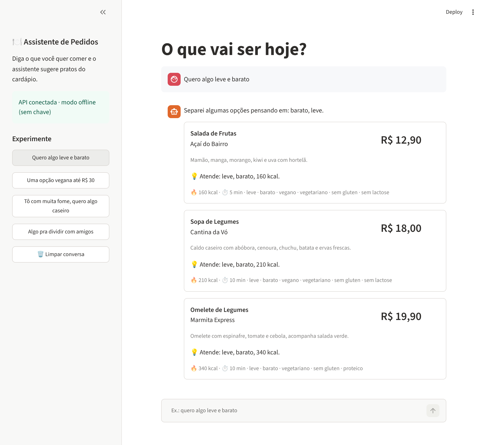

# 🍽️ Assistente de Pedidos com LLM

Chat que recomenda pratos de um cardápio em JSON a partir de pedidos em linguagem natural,
no estilo de um app de delivery: *"quero algo leve e barato"*, *"uma opção vegana até R$ 30"*.



**Stack:** Python · FastAPI · Streamlit · API da Anthropic (Claude) com saída estruturada · pytest

```
┌──────────────┐  POST /chat   ┌───────────────┐  messages.parse   ┌─────────────┐
│  Streamlit   │ ────────────▶ │    FastAPI    │ ────────────────▶ │  LLM (API)  │
│  (chat + UI) │ ◀──────────── │  + validação  │ ◀──────────────── │             │
└──────────────┘  JSON pratos  └──────┬────────┘  RespostaModelo   └─────────────┘
                                      │ lê
                               data/cardapio.json
```

## Destaques

- **Saída estruturada:** o LLM responde num schema Pydantic (`RespostaModelo`), sem parsing
  frágil de texto livre.
- **Sem alucinação de pratos:** a API confere cada `prato_id` sugerido contra o cardápio e
  descarta IDs inventados ou repetidos antes de responder (`app/servico.py`).
- **Funciona sem chave de API:** sem `ANTHROPIC_API_KEY`, entra um recomendador heurístico
  por palavras-chave (leve, barato, vegano, "até R$ 25", pizza...). Bom para demo e CI.
- **Conversa com contexto:** o histórico do chat é enviado junto, então "e algo mais barato?"
  funciona.
- **Testável:** o recomendador é injetado via `Depends`, e os testes usam um LLM falso
  (nenhuma chamada paga no CI).

## Como rodar

```bash
python -m venv .venv && source .venv/bin/activate
pip install -r requirements-dev.txt
cp .env.example .env   # opcional: coloque sua ANTHROPIC_API_KEY
```

Em um terminal, a API:

```bash
uvicorn app.main:app --reload
```

Em outro, a tela:

```bash
streamlit run frontend/streamlit_app.py
```

- Chat: http://localhost:8501
- Docs interativas da API (Swagger): http://localhost:8000/docs

Testes:

```bash
pytest -q
```

## Endpoints

| Método | Rota        | Descrição                                                    |
|--------|-------------|--------------------------------------------------------------|
| GET    | `/health`   | Status e modo atual (`llm` ou `offline`)                     |
| GET    | `/cardapio` | Lista pratos; filtros opcionais `categoria`, `preco_max`, `tag` |
| POST   | `/chat`     | Recebe `mensagem` + `historico` e devolve resposta e pratos  |

Exemplo:

```bash
curl -s localhost:8000/chat -H 'content-type: application/json' \
  -d '{"mensagem": "quero algo leve e barato"}'
```

```json
{
  "resposta": "Separei algumas opções pensando em: barato, leve.",
  "sugestoes": [
    {"prato": {"id": "p21", "nome": "Salada de Frutas", "preco": 12.9, "...": "..."},
     "motivo": "Atende: leve, barato, 160 kcal."}
  ],
  "modo": "offline"
}
```

## Estrutura

```
app/
  main.py          # rotas FastAPI e injeção de dependências
  servico.py       # junta recomendador + cardápio e valida os IDs sugeridos
  recomendador.py  # RecomendadorClaude (LLM) e RecomendadorHeuristico (offline)
  cardapio.py      # carrega e filtra o cardápio JSON
  models.py        # schemas Pydantic (API e saída do LLM)
  config.py        # configurações via .env
frontend/
  streamlit_app.py # tela de chat
data/
  cardapio.json    # 22 pratos fictícios de 8 restaurantes
tests/             # pytest (API, heurística e montagem da chamada ao LLM)
```

## Configuração

| Variável            | Padrão            | Descrição                                       |
|---------------------|-------------------|-------------------------------------------------|
| `ANTHROPIC_API_KEY` | —                 | Sem ela, roda no modo offline                   |
| `MODELO_LLM`        | `claude-opus-5-5` | Modelo usado nas recomendações                  |
| `ESFORCO_LLM`       | `low`             | `low`/`medium`/`high`: mais esforço = mais lento e caro |
| `MAX_SUGESTOES`     | `3`               | Máximo de pratos por resposta                   |
| `API_URL`           | `http://localhost:8000` | Endereço da API usado pelo Streamlit      |

Para trocar o cardápio, edite `data/cardapio.json` mantendo os campos de `Prato` em `app/models.py`.

## Próximos passos

- Streaming da resposta no chat
- Carrinho e cálculo de total/frete
- Cardápio vindo de um banco (SQLite/Postgres) em vez de JSON
- Dockerfile + docker-compose para subir API e tela juntas

---

Projeto de estudo, sem vínculo com nenhuma empresa de delivery. Pratos e restaurantes são fictícios.
